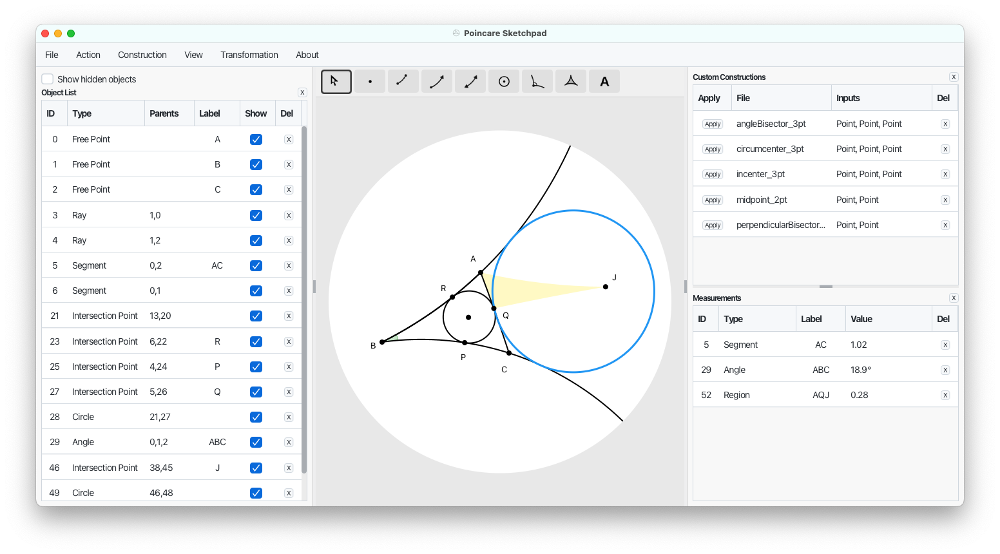

<p align="center">
  
</p>

<h1 align="center">Poincare Sketchpad</h1>

<p align="center">
  A desktop application for creating geometric constructions in the Poincare disk model of hyperbolic geometry.
</p>



## Features

- **Compass-and-straightedge tools** — construct points, lines, rays, segments, circles, angles, and regions on the hyperbolic plane
- **Dynamic geometry** — drag free points and watch the entire construction update in real time
- **Intersection detection** — automatic intersection previews between geodesics and circles
- **Measurements** — measure hyperbolic segment lengths, angles, circle circumferences, and region areas
- **Custom constructions** — record a sequence of steps, save it, and reapply it with different inputs
- **Built-in constructions** — midpoint, perpendicular line, and reflection point
- **Transformations** — apply Mobius translations and rotations with live preview
- **Export** — save diagrams as PNG or SVG with canvas or custom crop methods
- **Undo/redo** — full snapshot-based undo history

## Download

Download the latest release from the [Releases](https://github.com/cartowong/poincare-sketchpad/releases) page.

### macOS

Download the `.dmg` file, open it, and drag **Poincare Sketchpad** to your Applications folder.

> **Note:** The app is not code-signed. On first launch, macOS will block it. To open it:
> 1. Double-click the app to trigger the warning, then dismiss it.
> 2. Go to **System Settings → Privacy & Security**.
> 3. Scroll down to find the message about Poincare Sketchpad being blocked.
> 4. Click **Open Anyway** and enter your password.

### Windows

Download the `.msi` file and run it to install **Poincare Sketchpad**. The installer lets you choose the installation directory and optionally adds a Start menu entry.

### Linux

Pre-built installers are not yet available. See [Building from Source](#building-from-source) below.

## Building from Source

> The rest of this README is for developers who want to build the project from source. If you just want to use the app, download the installer from the [Releases](https://github.com/cartowong/poincare-sketchpad/releases) page above.

### Prerequisites

#### Java Development Kit (JDK) 21

The project requires **JDK 21** or later.

**macOS** (via [Homebrew](https://brew.sh)):

```bash
brew install openjdk@21
```

After installing, follow the instructions Homebrew prints to symlink it, or add it to your `PATH`:

```bash
sudo ln -sfn $(brew --prefix openjdk@21)/libexec/openjdk.jdk /Library/Java/JavaVirtualMachines/openjdk-21.jdk
```

**Windows** (via [winget](https://learn.microsoft.com/en-us/windows/package-manager/winget/)):

```powershell
winget install EclipseAdoptium.Temurin.21.JDK
```

**Linux** (Debian/Ubuntu):

```bash
sudo apt install openjdk-21-jdk
```

Verify the installation:

```bash
java -version
```

You should see output indicating version 21 or later.

#### Gradle

You do **not** need to install Gradle separately. The project includes the Gradle Wrapper (`gradlew` / `gradlew.bat`), which automatically downloads the correct Gradle version on first run.

### Run the application

```bash
./gradlew run
```

On Windows, use `gradlew.bat run` instead.

#### Troubleshooting: JavaFX `ArrayIndexOutOfBoundsException` on macOS

If `./gradlew run` fails with `java.lang.ArrayIndexOutOfBoundsException` at `Screen.getMainScreen`, JavaFX cannot connect to the macOS window server. Reset the window server by restarting the Dock:

```bash
killall Dock
```

Then retry `./gradlew run`. If the issue persists, check for stuck Java processes (`ps aux | grep java`) and kill them.

### Run the tests

```bash
./gradlew test
```

### Package as a native installer

```bash
./gradlew jpackage
```

This produces a platform-specific installer:
- **macOS**: `build/jpackage/PoincareSketchpad-1.0.0.dmg`
- **Windows**: `build/jpackage/PoincareSketchpad-1.0.0.msi`

On macOS, you can also build just the `.app` bundle (faster, useful for testing):

```bash
./gradlew jpackageImage
```

The output will be at `build/jpackage/Poincare Sketchpad.app`.

## Changelog

See [CHANGELOG.md](CHANGELOG.md) for the version history.

## License

This project is licensed under the [MIT License](LICENSE).
